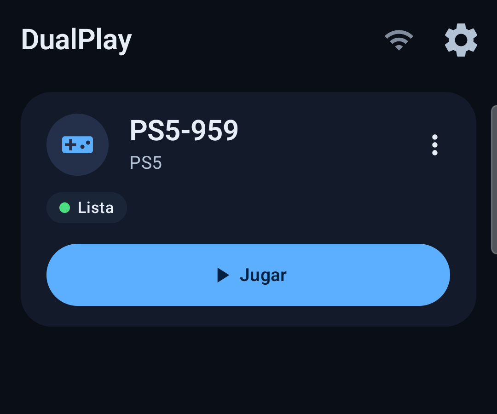
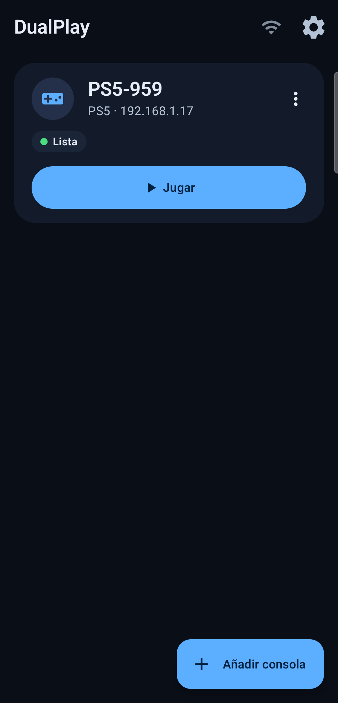

# DualPlay

[English](README.md) · **Español**

DualPlay es un cliente Android de Remote Play (Uso remoto) para PlayStation 5 y PlayStation 4, hecho como fork de
[chiaki-ng](https://github.com/streetpea/chiaki-ng) (que a su vez continúa [Chiaki](https://git.sr.ht/~thestr4ng3r/chiaki)).
Se centra en sacarle partido a un teléfono y un DualSense: vídeo HDR, gatillos adaptativos y háptica HD por Bluetooth
normal, y una interfaz moderna en Jetpack Compose en español e inglés.

> **Estado: v0.1.0-alpha.** Funciona en el Samsung Galaxy S23 FE del autor (Android 16) y no se ha probado en nada más.
> Esperable que haya asperezas. Ver [Limitaciones](docs/LIMITACIONES.md).

<p align="center">
  
  
</p>

## Funciones

- **Vídeo HDR10.** HEVC Main10 con el decodificador de hardware `MediaCodec`, con respaldo automático a HEVC SDR y H.264.
  El vídeo nunca se decodifica por software.
- **Gatillos adaptativos del DualSense** por Bluetooth, sin cable ni root.
- **Háptica HD del DualSense** por Bluetooth (experimental), con la vibración del teléfono como alternativa.
- **Giroscopio** y **panel táctil** del DualSense, enviados a la consola.
- **Asignación de botones** para cualquier mando que Android reconozca (Xbox, 8BitDo, Flydigi…), incluidos botones extra y paletas.
- **Micrófono del teléfono** para el chat de voz (Opus, con cancelación de eco).
- **Controles en pantalla** con opacidad ajustable, para cuando no hay mando a mano.
- Detección de consolas, despertar desde reposo, registro con PIN e inicio de sesión PSN opcional para rellenar tu Account ID.
- Interfaz en **español e inglés**.

## Requisitos

- Android 12 o superior (minSdk 31). Desarrollado y probado solo en un Galaxy S23 FE (SM-S711B, Android 16).
- Una PS5 o PS4 con el Uso remoto activado, en la misma red que el teléfono. Se recomienda mucho el Wi-Fi de 5 GHz.
- Para los extras del DualSense: un DualSense emparejado con el teléfono por Bluetooth.
- El HDR necesita una pantalla que informe de compatibilidad con HDR10.

## Instalar

Descarga el APK desde la página de [Releases](../../releases) y comprueba su suma SHA-256 con la de las notas de la versión.
La primera vez Android te pedirá permitir instalar apps desde el navegador o el gestor de archivos.

## Compilar desde el código

La parte nativa (la librería de Chiaki, Opus, OpenSSL…) solo compila en un **host Linux** (Linux nativo o WSL2).

Requisitos: JDK 17, Android SDK con NDK `28.2.13676358` (fijado en `android/app/build.gradle`), CMake 3.22.1,
`python3` con el módulo `protobuf`, `git`, `make`, `perl`.

```bash
git clone --recursive https://github.com/maicolloaiza10150/DualPlay.git
cd DualPlay/android
./gradlew :app:assembleDebug          # solo arm64-v8a
./gradlew :app:testDebugUnitTest      # tests JVM (parsers, constructores de reportes, asignación de botones)
adb install -r app/build/outputs/apk/debug/app-debug.apk
```

Para firmar con tu propia clave, guarda el keystore **fuera** del repositorio y apúntalo desde `android/local.properties`
(`chiakiKeystore`, `chiakiKeystorePW`, `chiakiKeyAlias`, `chiakiKeyPW`). Ese archivo está en `.gitignore`.

Más detalle sobre cómo está montado en [docs/ARCHITECTURE.md](docs/ARCHITECTURE.md). La lista de pruebas manuales está en
[docs/CHECKLIST-PRUEBAS.md](docs/CHECKLIST-PRUEBAS.md).

## Limitaciones, sin rodeos

- **Usa APIs ocultas de Android.** Los gatillos adaptativos y la háptica HD se envían con `BluetoothHidHost.sendData`, que no
  forma parte del SDK público; DualPlay llega a ella con `hiddenapibypass`. Una actualización futura de Android o One UI puede
  romperla. Si falla, la app sigue funcionando como cliente de Remote Play normal, sin gatillos ni háptica HD.
- Probado en **un solo teléfono**. Otros dispositivos, versiones de Android y mandos pueden comportarse distinto.
- La háptica HD no es idéntica a la de una PS5 y puede cortarse con interferencias de 2,4 GHz.
- El micrófono y el altavoz del DualSense por Bluetooth son **imposibles** sin root o hardware extra; solo se admite el
  micrófono del teléfono.
- El OpenSSL incluido es la 1.1.1w, heredada de la compilación Android de upstream. Esa rama ya no tiene soporte; pasar a una
  versión mantenida está pendiente.

La lista completa está en [docs/LIMITACIONES.md](docs/LIMITACIONES.md).

## Privacidad y seguridad

Los tokens de PSN, Account ID, claves de registro y PIN nunca se suben al repositorio. En ejecución el Account ID se guarda
cifrado (`EncryptedSharedPreferences`) y los registros de sesión se redactan. El archivo de ajustes exportado puede contener
tus claves de Remote Play: no lo compartas.

## Aviso legal

DualPlay es un proyecto independiente. **No está afiliado, respaldado ni patrocinado por Sony Interactive Entertainment LLC.**
«PlayStation», «PS5», «PS4», «DualSense» y marcas relacionadas pertenecen a sus propietarios y solo se usan para describir
compatibilidad.

## Licencia y créditos

DualPlay es software libre bajo la **GNU Affero General Public License v3.0 con la excepción de OpenSSL** (ver
[COPYING](COPYING) y [LICENSES/](LICENSES)). Deriva de:

- [chiaki-ng](https://github.com/streetpea/chiaki-ng) de streetpea y colaboradores — [README original](README.chiaki-ng.md);
- [Chiaki](https://git.sr.ht/~thestr4ng3r/chiaki) de Florian Märkl (thestr4ng3r) y colaboradores.

Los componentes de terceros están en [THIRD-PARTY-NOTICES.md](THIRD-PARTY-NOTICES.md). Los avisos de copyright de Chiaki y
chiaki-ng se mantienen intactos en los archivos fuente.
